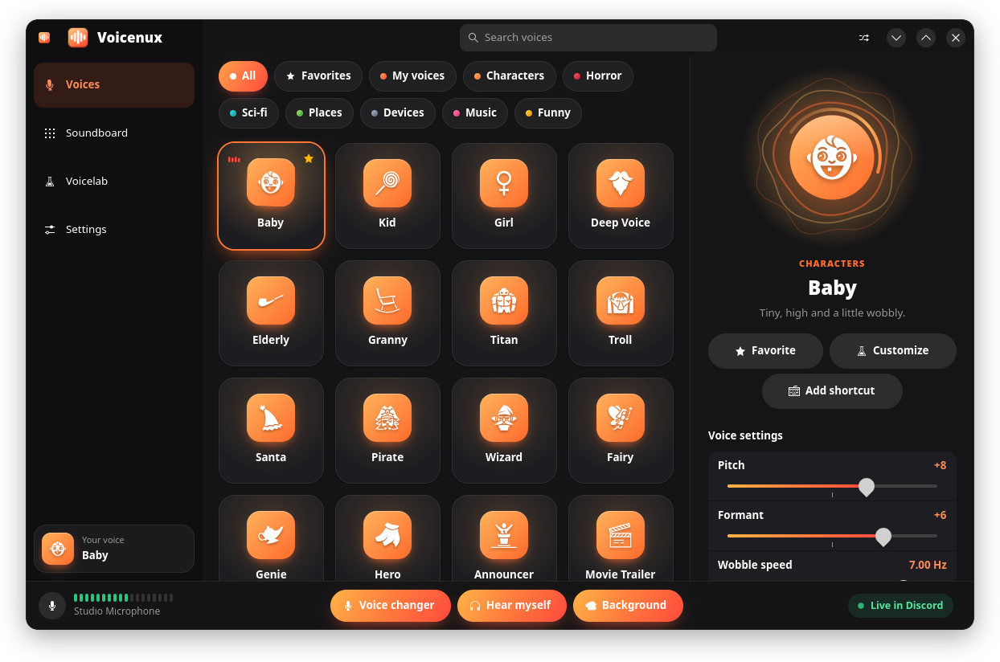
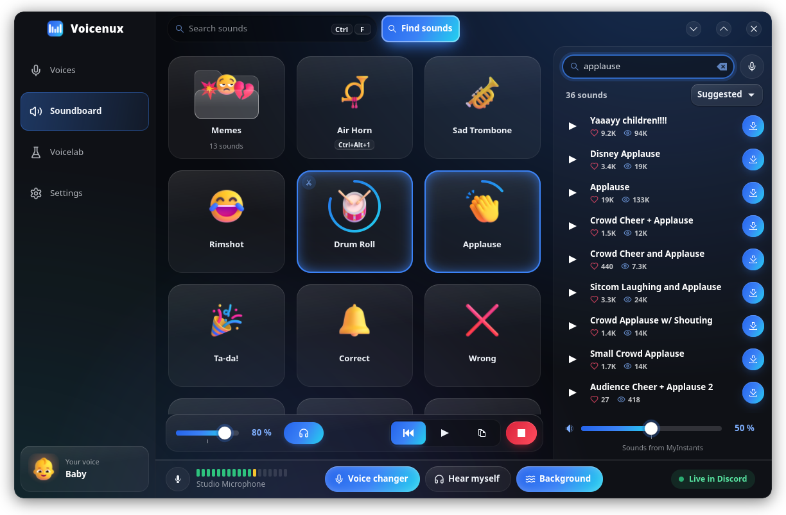
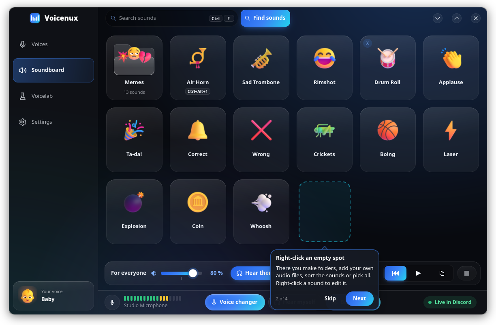
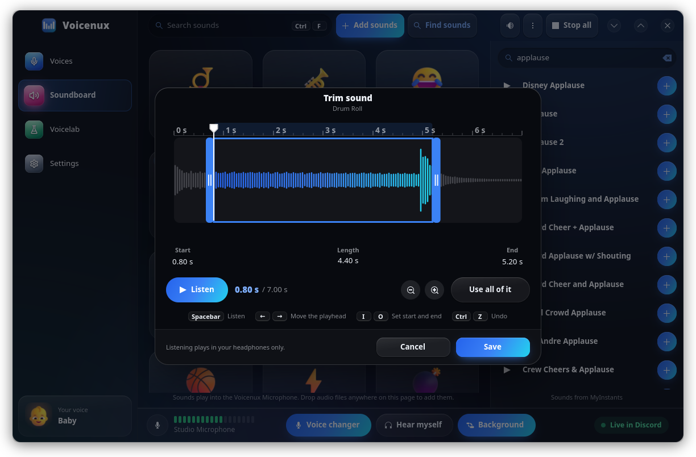
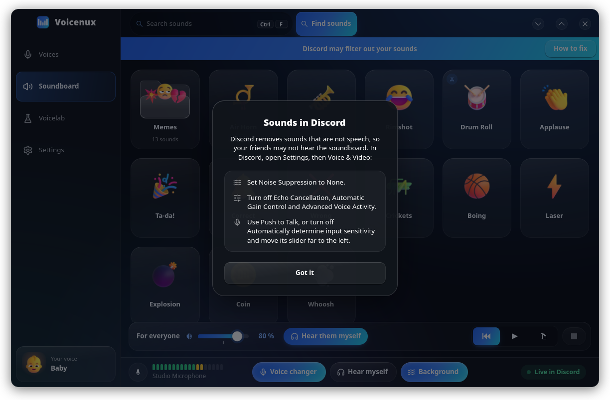
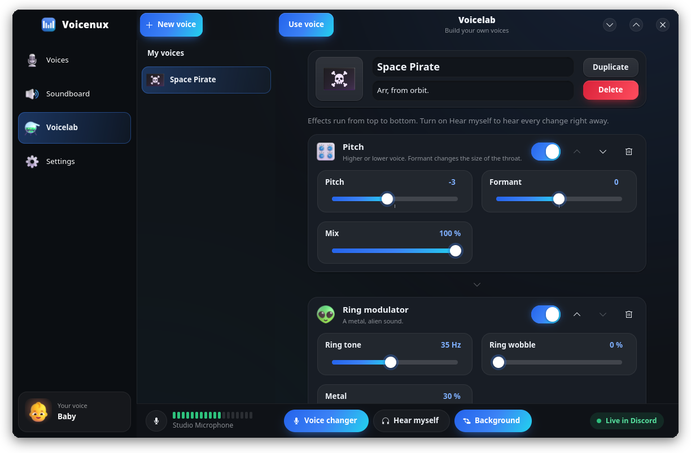
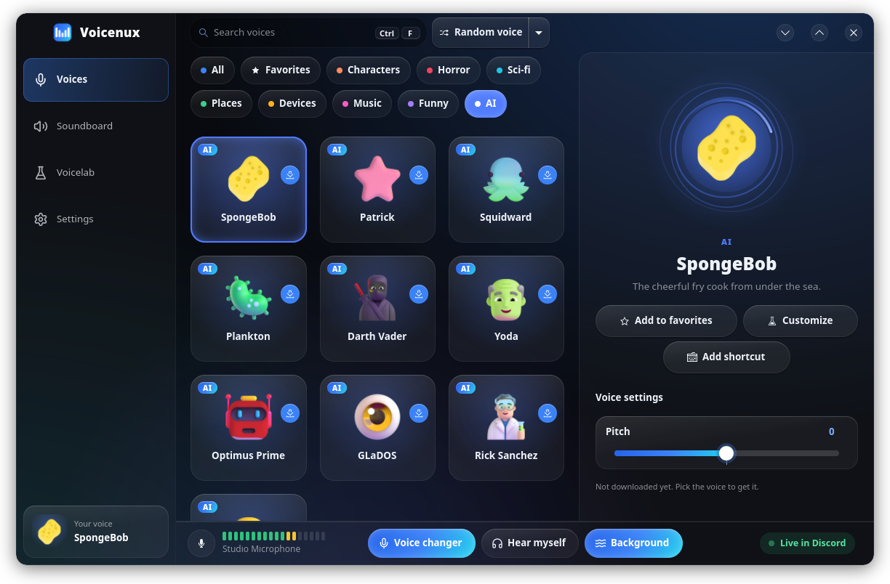
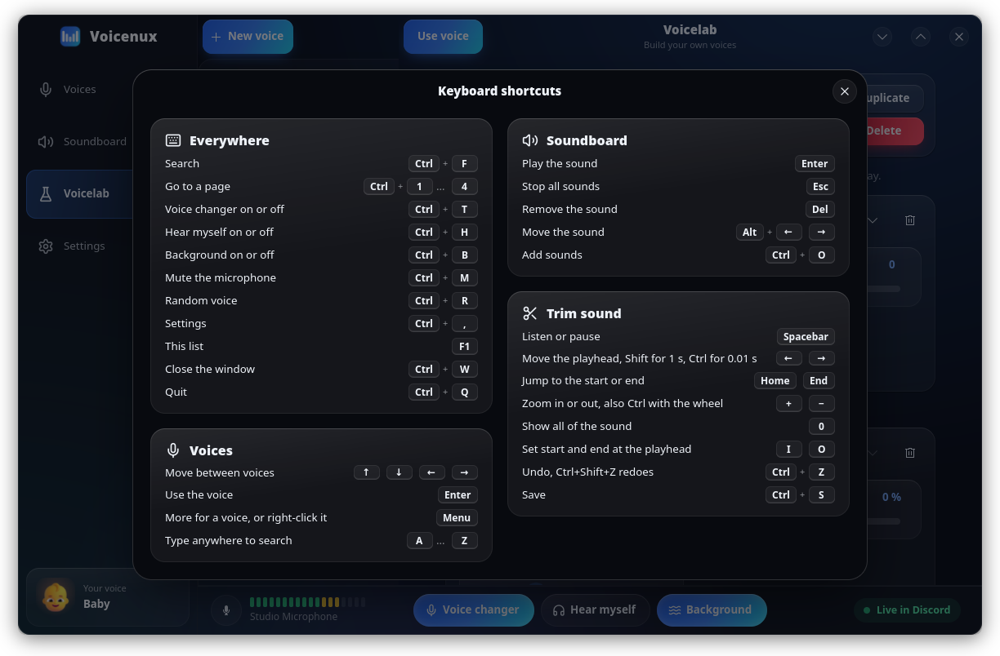
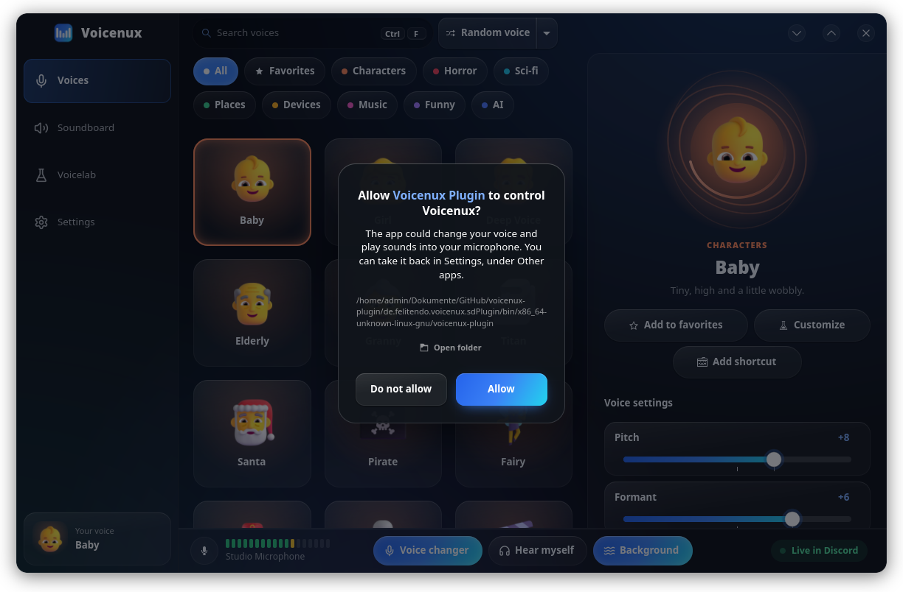
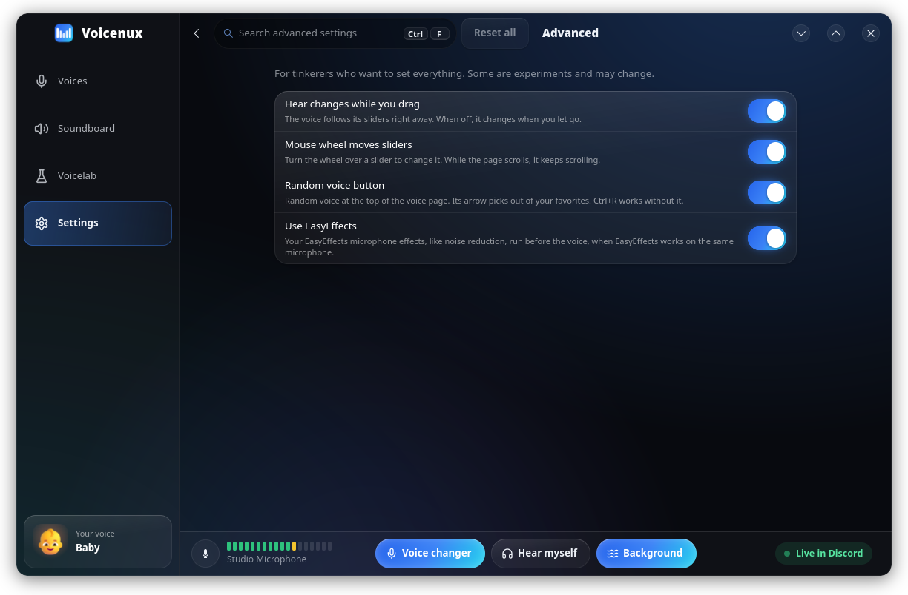

<p align="center">
  
</p>

<h1 align="center">Voicenux</h1>

<h3 align="center">The voice changer (and soundboard) for Linux.</h3>

<p align="center">
  Change your voice in real time in Discord, games, OBS and any other app.<br>
  69 voices, a soundboard and a lab to build your own. Made for PipeWire.
</p>

<h5 align="center">
  <a href="#install">Install</a> |
  <a href="#how-to-use">How to use</a> |
  <a href="#voices">Voices</a> |
  <a href="https://github.com/voicenux/voicenux/issues">Report a bug</a>
</h5>

<p align="center">
  <a href="https://ko-fi.com/felitendo"></a>
</p>

<p align="center">
  
  
</p>

## Install

<details>
<summary><b>Arch</b>, CachyOS, EndeavourOS, Manjaro</summary>

```bash
yay -S voicenux-bin
```

</details>

<details>
<summary><b>Fedora</b></summary>

```bash
sudo curl -fsSL -o /etc/yum.repos.d/voicenux.repo https://voicenux.github.io/voicenux/voicenux.repo && sudo dnf install voicenux
```

</details>

<details>
<summary><b>Debian</b> 13, Ubuntu 26.04</summary>

```bash
curl -fsSL https://voicenux.github.io/voicenux/KEY.gpg | sudo gpg --dearmor -o /etc/apt/keyrings/voicenux.gpg && echo "deb [signed-by=/etc/apt/keyrings/voicenux.gpg] https://voicenux.github.io/voicenux/deb/$(. /etc/os-release && echo $VERSION_CODENAME) ./" | sudo tee /etc/apt/sources.list.d/voicenux.list && sudo apt update && sudo apt install voicenux
```

</details>

<details>
<summary><b>Flatpak</b>, any distribution</summary>

```bash
curl -fsSLO https://github.com/voicenux/voicenux/releases/latest/download/voicenux-x86_64.flatpak && flatpak install --user voicenux-x86_64.flatpak
```

</details>

<details>
<summary>Build from source</summary>

```bash
make && sudo make install
```

Needs Rust, Clang, PipeWire, GTK 4.16 and libadwaita 1.7 or newer, with their development files.

</details>

## How to use

1. Open Voicenux and click a voice.
2. In Discord, OBS or your game, pick **Voicenux Microphone** as the microphone.
3. Turn on **Hear myself** to hear yourself. Wear headphones.

Closing the window keeps Voicenux running in the tray. F1 shows all keys.

<details>
<summary>Voices</summary>

<p align="center">
  
</p>

Click a voice to use it, and click it again for your own voice. Search or pick a category at the
top. Star the ones you like to find them under **Favorites**. Right-click an empty spot for
folders. Drag voices to sort them. **Random voice** picks one for you, and its arrow switches it to
your favorites.

On the right you change the main settings of the voice, like its pitch. **Customize** opens all of
them in Voicelab. Right-click a voice to give it a shortcut. At the bottom, **Voice changer** turns
the voice on and off, **Hear myself** plays it in your headphones, and **Background** adds its
sound, like rain or a campfire.

</details>

<details>
<summary>Soundboard</summary>

<p align="center">
  
</p>

Sounds play into the Voicenux Microphone, so others hear them too. **Find sounds** searches
[MyInstants](https://www.myinstants.com): type, or click the microphone and say what you want. Or drop your own audio files on the page. Right-click a
sound to change or trim it, right-click an empty spot for folders. Starred sounds come first.
Tips on the first visit show what is where. Friends in Discord do not hear them? Discord filters
out sounds that are not speech: Voicenux shows you what to change there.

<p align="center">
  
  
  
</p>

</details>

<details>
<summary>Voicelab</summary>

<p align="center">
  
</p>

Build your own voice from 26 effects, like pitch, robot, auto-tune, echo, reverb and AI voices.
**Customize** on a voice starts from that one.

</details>

<details>
<summary>AI voices</summary>

<p align="center">
  
</p>

Characters like SpongeBob, Darth Vader and GLaDOS, with an [RVC](https://github.com/RVC-Project/Retrieval-based-Voice-Conversion-WebUI)
model. Best on an NVIDIA graphics card, or an AMD one from the RX 6000 on, with about 0.3 s of
delay. Without one, turn on **Run on the processor** in Settings. The first AI voice downloads the
AI engine once (about 8 GB, 18 GB for AMD, or 3 GB for the processor).

</details>

<details>
<summary>Shortcuts, command line and Stream Deck</summary>

<p align="center">
  
</p>

Global shortcuts are in Settings, and every voice and sound can get its own. `voicenux --help`
lists the commands, like `voicenux voice robot` or `voicenux sound airhorn`.

For a Stream Deck, the official [Voicenux plugin](https://github.com/voicenux/voicenux-plugin) for
OpenDeck puts your voices and sounds on its keys. Turn on **Other apps** in Settings for it. Other
plugins and scripts can control Voicenux the same way, see [API.md](API.md). Voicenux asks before a
new app may control it.

<p align="center">
  
</p>

</details>

<details>
<summary>Advanced settings</summary>

<p align="center">
  
</p>

At the bottom of Settings, **Advanced settings** has switches for tinkerers, like the flags of a
browser. Some are experiments and may change.

</details>

## Voices

<details>
<summary>All 69 voices</summary>

| Category | Voices |
|---|---|
| Characters | Baby, Girl, Deep Voice, Elderly, Granny, Titan, Santa, Pirate, Fairy, Genie, Announcer, Movie Trailer |
| Horror | Demon, Monster, Zombie, Ghost, Vampire, Witch, Dragon, Goblin, Dark Lord, Creepy Clown |
| Sci-fi | Robot, Alien, Cyborg, Invader, Astronaut, Glitch, Hologram |
| Places | Echo, Cave, Cathedral, Shower, Stadium, Underwater, Deep Space, Storm, Campfire, Forest |
| Devices | Radio, Telephone, Walkie-Talkie, Megaphone, 1920s Film, Potato Mic, 8-Bit, Fan |
| Music | Auto-Tune, Angel Choir, Magic Chords, Talk Box, Duet |
| Funny | Chipmunk, Helium, Drunk, Dizzy, Whisper, Frog, Duck |
| AI | SpongeBob, Patrick, Squidward, Plankton, Darth Vader, Yoda, Optimus Prime, GLaDOS, Rick Sanchez, Homer Simpson |

</details>

## Credits

- [Fluent Emoji](https://github.com/microsoft/fluentui-emoji) by Microsoft (MIT), with names in the other languages from [Unicode CLDR](https://cldr.unicode.org), and [Lucide](https://lucide.dev) (ISC) for the pictures and icons.
- Background sounds: CC0 recordings from [Freesound](https://freesound.org), see [SOURCES.md](data/ambience/SOURCES.md).
- RNNoise by Xiph.Org through [nnnoiseless](https://github.com/jneem/nnnoiseless), Freeverb by Jezar at Dreampoint, [Symphonia](https://github.com/pdeljanov/Symphonia).
- AI voices: [infer-rvc-python](https://github.com/R3gm/infer_rvc_python) (MIT) and models shared on Hugging Face.
- Switch sounds: [Interface Sounds](https://kenney.nl/assets/interface-sounds) by Kenney (CC0), see [SOURCES.md](data/feedback/SOURCES.md).
- Speech recognition for apps: [Whisper](https://github.com/openai/whisper) by OpenAI (MIT), run by [candle](https://github.com/huggingface/candle).

BSD-3-Clause.
